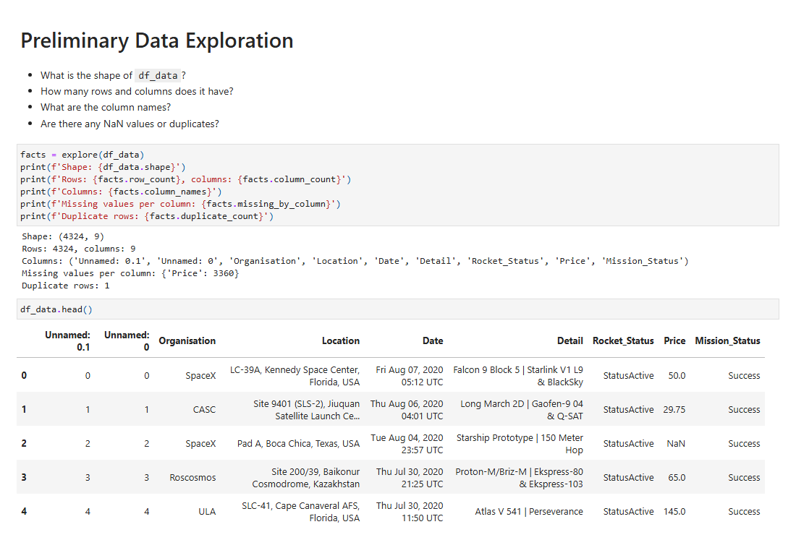
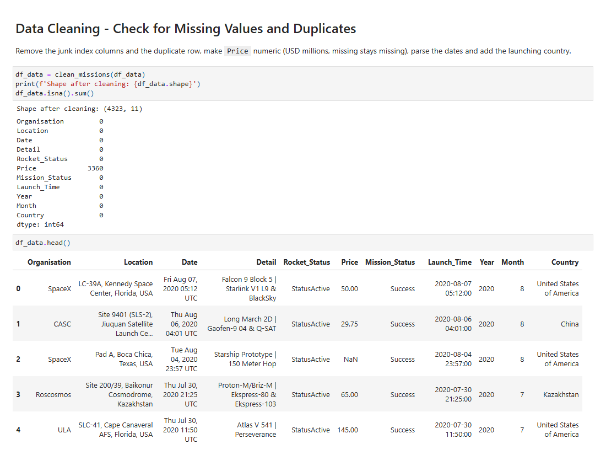
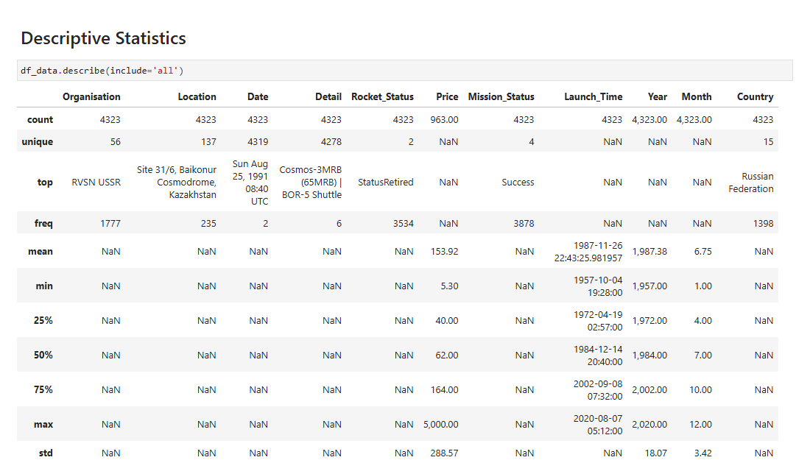
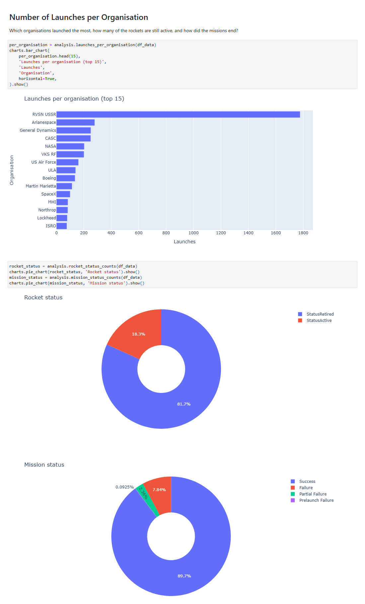
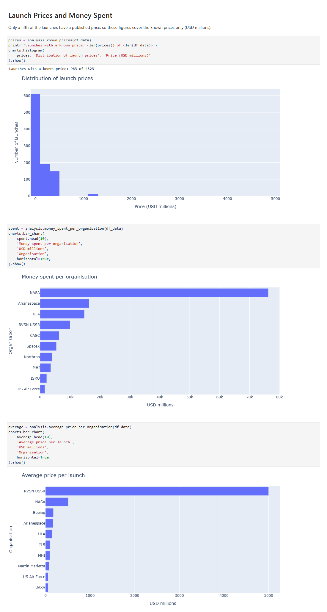
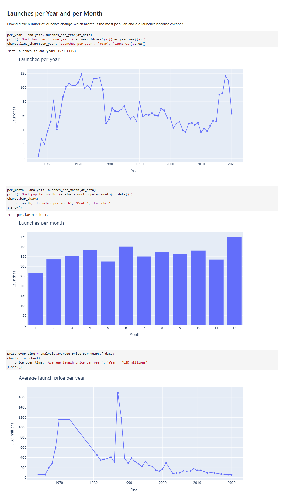
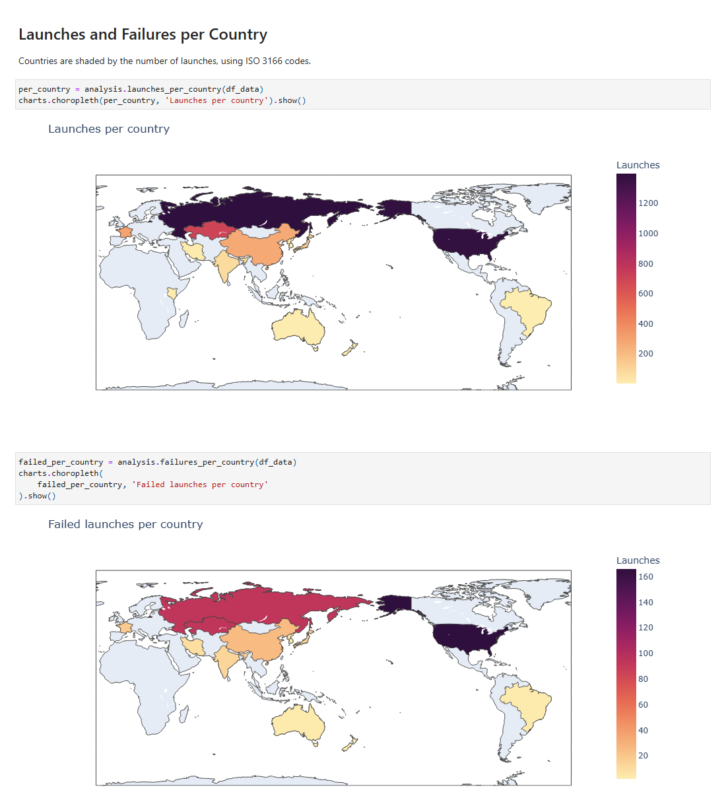
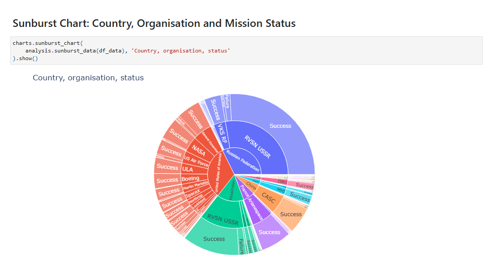
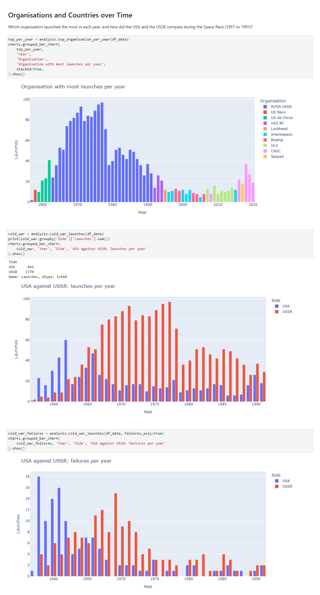
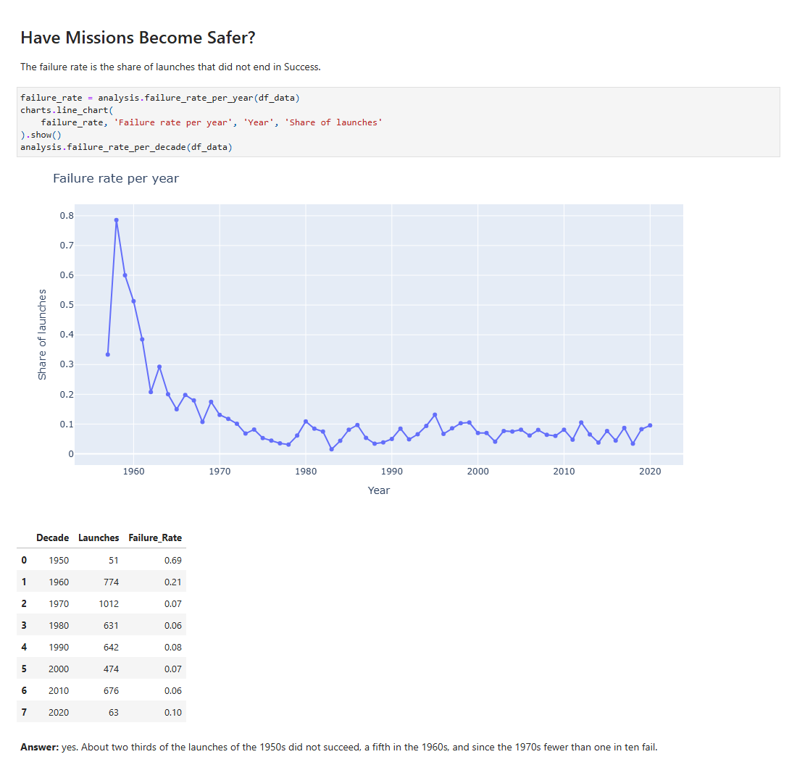

<!-- README from the framework template (framework/templates/README-template.md). -->

# 🚀 Space Race Analysis

Analyse and visualise the space missions since 1957: who launched most, what a launch costs, when launches happen and whether missions got safer. Day 99 assignment of the Udemy course "100 Days of Code: The Complete Python Pro Bootcamp", for course participants and anyone browsing for ideas.

## 📚 Table of Contents

- [Overview](#-overview)
- [Requirements](#-requirements)
- [Setup](#-setup)
- [Data](#-data)
- [Run](#-run)
- [Lecture steps](#-lecture-steps)
- [Tests](#-tests)
- [License](#-license)
- [Links](#-links)
- [Appendix: Project documents](#-appendix-project-documents)

## 🧭 Overview

The project analyses the nextspaceflight.com mission data supplied with the assignment and answers its questions with a Jupyter notebook. The notebook calls small, tested functions.

| Folder | Purpose |
| --- | --- |
| `src/space_race/` | The Python package; all constants are in `constants.py` |
| `tests/` | The pytest tests |
| `docs/` | Project documents, screenshots of each lecture step and the wiki |

The package has no runtime dependencies. The libraries the notebook needs (pandas, plotly and others) are an optional extra named `notebook`.

## 📋 Requirements

- Python 3.14 or newer, to run the package (`py -3.14 --version` on Windows, `python3.14 --version` elsewhere).
- Git, to clone the repository.
- Doxygen, only to build the source documentation.

## 🛠️ Setup

Create and use a local virtual environment named `.venv` in the repository root.

Windows (PowerShell):

```powershell
py -3.14 -m venv .venv
.venv\Scripts\Activate.ps1
python -m pip install --upgrade pip
python -m pip install -e ".[dev,notebook]"
```

Linux and macOS:

```bash
python3.14 -m venv .venv
source .venv/bin/activate
python -m pip install --upgrade pip
python -m pip install -e ".[dev,notebook]"
```

Leave the environment with `deactivate`. Install only `".[dev]"` if you want the tests and no notebook libraries.

## 📥 Data

The data file is not in the repository. Get it from the course resources (`Space Missions (start).zip` of the Day 99 assignment), unzip it and put `mission_launches.csv` in `data/raw/`, which git ignores. The file has 4,324 data rows and this SHA-256 checksum:

```text
ae8097c187d910380a92c5258582981246856766e31541687f04909e78888084
```

Check it with `Get-FileHash data\raw\mission_launches.csv` (PowerShell) or `sha256sum data/raw/mission_launches.csv`.

## ▶️ Run

Start Jupyter with the environment active, then open the notebook:

```bash
python -m jupyterlab
```

Build the source documentation (output in `docs/doxygen/`):

```bash
doxygen Doxyfile
```

Open `notebooks/space_missions_analysis.ipynb`. To make the screenshots of the lecture steps again (a headless browser renders them, no window opens):

```bash
python tools/build_notebook.py
python tools/capture_steps.py
```

## 🖼️ Lecture steps

Each step of the assignment, as the notebook shows it. The [wiki][documentation] explains what each step taught, in English, Danish and Bahasa Malaysia, and holds the reflection journal.

### 1. Preliminary data exploration



### 2. Data cleaning



### 3. Descriptive statistics



### 4. Launches per organisation and rocket status



### 5. Launch prices and money spent



### 6. Launches per year, month and over time



### 7. Country analysis with choropleth maps



### 8. Sunburst chart



### 9. Organisations and countries over time



### 10. Mission safety over time



## 🧪 Tests

```bash
python -m pytest
```

Before each push, run the static analysis with opengrep:

```powershell
& "$HOME\.opengrep\cli\latest\opengrep.exe" scan --config p/python --config p/security-audit --config p/default --error src tools tests
```

## 📄 License

GNU Affero General Public License v3.0: see [LICENSE](./LICENSE).

## 🔗 Links

- [Repository][repository]
- [Documentation][documentation]
- [Issue tracker][issues]

## 📎 Appendix: Project documents

The documents a newcomer needs, in reading order.

| Document | What it tells you |
| --- | --- |
| [AGENTS.md][agents] | The working rules of this repository |
| [Business Case][BC-001] | Why the project exists, its scope and success criteria |
| [Stakeholder Analysis][SA-001] | Who is involved; the stakeholder IDs used for owners and reviewers |
| [Project Plan][PP-001] | The gateways and their schedule |
| [Milestones][milestones] | One document per gateway: Go/No-Go criteria and tasks |
| [Artifact registry][registry] | Where each artifact type lives, the next version, the PO language and domain |
| [Framework README][framework-readme] | The framework this project uses |
| [Framework changelog][framework-changelog] | What changed in each framework release |

---

[repository]: https://git.tirsystem.com/Tirsvad-Udemy-100-days-of-code/099-assignment-analyse-and-visualise-the-space-race
[documentation]: https://git.tirsystem.com/Tirsvad-Udemy-100-days-of-code/099-assignment-analyse-and-visualise-the-space-race/wiki
[issues]: https://git.tirsystem.com/Tirsvad-Udemy-100-days-of-code/099-assignment-analyse-and-visualise-the-space-race/issues
[agents]: ./AGENTS.md
[BC-001]: ./docs/business-case.md
[SA-001]: ./docs/stakeholder-analysis.md
[PP-001]: ./docs/project-plan.md
[milestones]: ./docs/milestones/
[registry]: ./docs/artifact-registry.md
[framework-readme]: ./framework/README.md
[framework-changelog]: ./framework/CHANGELOG.md
