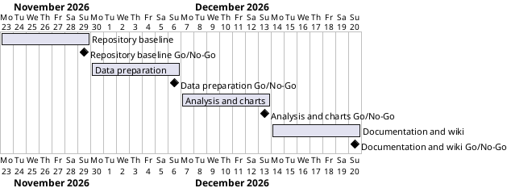

# Project Plan

## Metadata
| Key | Value |
| --- | --- |
| ID | PP-001 |
| CrossReference | [BC-001], [SA-001], [MIL-001], [MIL-002], [MIL-003], [MIL-004] |
| Language | en |
| Domain | it |

## Version History
| Date | Status | Author | Reviewer | Change | Commit |
| --- | --- | --- | --- | --- | --- |
| 2026-11-23 | Deprecated | Jens Tirsvad Nielsen | S01 | Initial version | pending |
| 2026-11-23 | Accepted | Jens Tirsvad Nielsen | S01 | Accepted after RC-003 (Go) | pending |

---

## Purpose

This plan schedules the four gateways of the Space Race analysis project over the Business Case constraint: a part-time effort by one person, ending by 2026-12-20.

## Planning Assumptions

- Week 1 starts 2026-11-23; the plan ends by 2026-12-20 (to be confirmed by the Product Owner, S01).
- Phase length: one week each, a pull request per gateway.
- S01 owns and reviews every gateway ([SA-001]).
- Data and plotting libraries are an optional extra, so the package keeps no runtime dependencies ([BC-001] Success Criterion 5).

## Gateway Schedule

| Gateway | Document | Window | Decision date | Owner | Stories | Main deliverable | Milestone |
| --- | --- | --- | --- | --- | --- | --- | --- |
| Repository baseline | [MIL-001] | 2026-11-23 to 2026-11-29 | 2026-11-29 | S01 | none (technical tasks) | A cloneable repository with `src/`, `tests/`, `docs/`, `pyproject.toml`, `constants.py`, a Python `.gitignore`, a Doxyfile, a README from the framework template that explains the local `.venv`, and a description and topics on the git host. | not yet synced |
| Data preparation | [MIL-002] | 2026-11-30 to 2026-12-06 | 2026-12-06 | S01 | none (technical tasks) | A tested loading and cleaning module, a notebook section for each of the two steps with its screenshot, and a recorded checksum of the data file. | not yet synced |
| Analysis and charts | [MIL-003] | 2026-12-07 to 2026-12-13 | 2026-12-13 | S01 | none (technical tasks) | The notebook sections for all analysis steps, backed by tested functions in `src/`, with one screenshot per step. | not yet synced |
| Documentation and wiki | [MIL-004] | 2026-12-14 to 2026-12-20 | 2026-12-20 | S01 | none (technical tasks) | A README with a screenshot for each lecture step, a wiki in English, Danish and Bahasa Malaysia in `docs/wiki/` explaining what each step taught, and the reflection journal. | not yet synced |



## Scope Coverage

| Business Case scope item | Gateway |
| --- | --- |
| Loading, exploring and cleaning the data | MIL-002 |
| Every analysis and chart of the assignment | MIL-003 |
| Python package, tests, pyproject.toml, .gitignore, Doxyfile | MIL-001 |
| venv documentation and README | MIL-001, MIL-004 |
| Screenshot per lecture step | MIL-002, MIL-003, MIL-004 |
| Wiki in English, Danish and Bahasa Malaysia | MIL-004 |
| Repository description and topics | MIL-001, MIL-004 |
| Local opengrep pass before each push | Every gateway |
| Reflection journal | MIL-004 |

## Dependencies

```
MIL-001 → MIL-002 → MIL-003 → MIL-004
```

A No-Go moves every later gateway by the time needed to fix it; the end date 2026-12-20 is then re-set by S01.

## Plan Risks

| Risk | Impact | Mitigation |
| --- | --- | --- |
| The data download link has expired | MIL-002 blocked | S01 supplies the zip file |
| Translating the wiki takes longer than a week | MIL-004 slips | Write the English pages as each step finishes, translate in MIL-004 |
| The three-language wiki doubles the review effort | Slip | Review English first, then check translations for structure and screenshots |

## Open Issues

- The end date 2026-12-20 is proposed; S01 confirms it.
- The start notebook of the assignment is needed to learn the function names S02 expects (MIL-002, task 1).
- Whether the data file may be committed depends on its licence (MIL-002, task 1).
- The framework records session prompts in a log folder; the repository is public through its mirror, so the folder is ignored by git, and no artifact names automated assistants.
- Whether the Gitea wiki is published by the framework's publish workflow or by hand is S01's decision at MIL-004.

---

[BC-001]: ./business-case.md
[SA-001]: ./stakeholder-analysis.md
[MIL-001]: ./milestones/mil-001-repository-baseline.md
[MIL-002]: ./milestones/mil-002-data-preparation.md
[MIL-003]: ./milestones/mil-003-analysis-and-charts.md
[MIL-004]: ./milestones/mil-004-documentation-and-wiki.md
